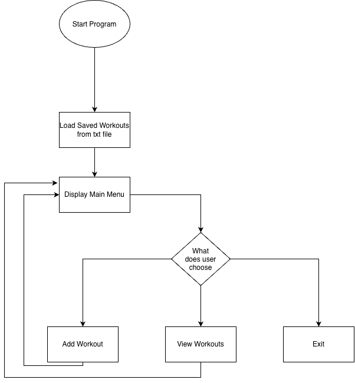

# Fitness Tracker

A simple Java program to record and view workouts.

## The Problem

I want to make it easier for people to keep track of their workouts and see their progress over time.

## How It Works

The program will allow users to:
- Add workouts with exercises, sets, reps, and weights.
- Save workouts to a text file.
- View past workouts.

### System Diagram

## Tech Stack

- **Language:** Java
- **Libraries:** Scanner, ArrayList, PrintWriter
- **Data Storage:** Text file
- **Tools:** VS Code, GitHub
- **External Data:** None

## Setup

1. Download the GitHub repository.
2. Open the project in VS Code.
3. Run the Java program once it is completed.

## Usage

The program will have a simple menu:

1. Add Workout
2. View Workouts
3. Exit

## Roadmap

- [ ] Add and save workouts
- [ ] View past workouts
- [ ] Show workout progress graphs
- [ ] Set workout goals
- [ ] Edit or delete workouts

## Project Documents

- [Eisenhower Matrix](docs/EisenhowerMatrix.pdf)
- [System Diagram](docs/SystemDiagram.png)

## Author

Aarav Khandelwal

**Status:** Currently in development.